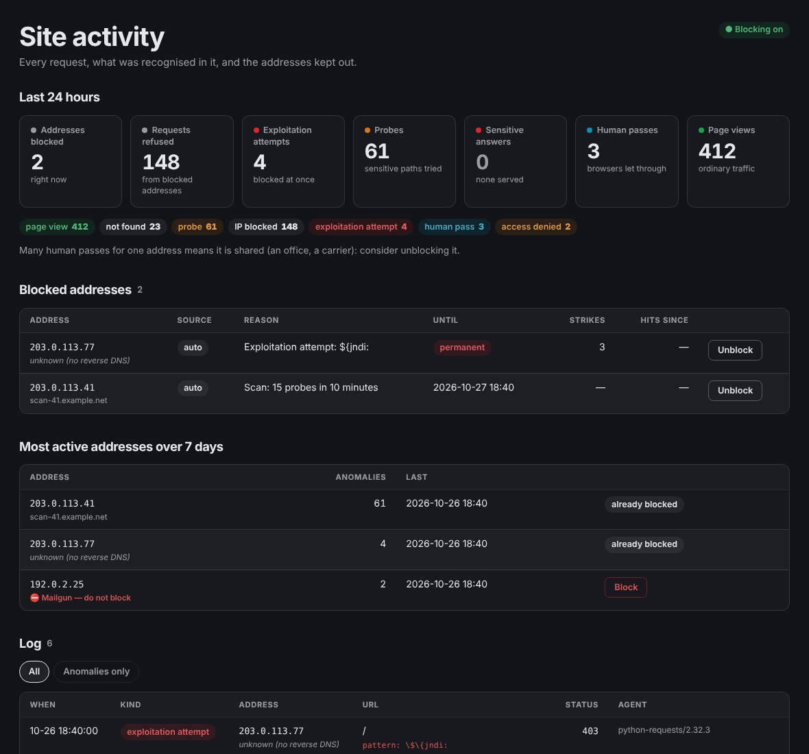

# Sentinelle

**Blocks attackers, never your mail provider.**

It logs every request, recognises exploitation attempts, closes the door on its
own and alerts you. And it refuses to ban an address your site depends on.



*Documentation française : [README.fr.md](README.fr.md)*

```bash
composer require acencyril/sentinelle-bundle
```

---

## The problem

A production site is probed constantly. Scanners look for `/.env`,
`/wp-login.php`, `/.git/config`. Others attempt SQL injection, directory
traversal, Log4Shell. Most of it goes nowhere — but you only know that
afterwards, and only if you look.

The usual answers each have a flaw. Reading web server logs: nobody does it every
day. `fail2ban`: it works on log files, outside the application, and knows
nothing about your routes or your users. A hosted WAF: it sees all your traffic,
and it costs money.

Sentinelle does the work **inside the application**, where you know who is
authenticated, which route answered, and what status code went out.

---

## What it does

**It records everything**, not just attacks. An attempt cannot be recognised on
its own: it is recognised by contrast with ordinary traffic. Without the page
views you are left with a list of alarms and no scale, unable to tell whether
three 404s are a scan or a dead link.

**It classifies every request** — page view, not found, access denied, probe,
exploitation attempt — from the path, the query string and the response code.

**It blocks on its own**, progressively: 24 hours on the first strike, 7 days on
the second, permanent on the third (configurable).

**It never locks out the people behind a blocked address.** A browser asking for
a page gets a one-click proof of work instead of a bare refusal, and is let
through; scripts and sensitive paths stay shut. See
[The human pass](#the-human-pass-blocked-but-not-locked-out).

**It emails you only when something got through**: a sensitive file or a secret
actually served with a 2xx. Every other alert (scans, exploitation attempts,
brute force) is counted in one daily digest. See
[When it emails you](#when-it-emails-you).

**It tells researchers where to write**: `/.well-known/security.txt` (RFC 9116),
its expiry date kept fresh by itself. And it sends your Content-Security-Policy
with a fresh nonce on every page. See
[security.txt and Content-Security-Policy](#securitytxt-and-content-security-policy).

**And it refuses to block what you depend on.** This is the piece missing
everywhere else, and the one that justifies this bundle.

---

## When it emails you

Out of the box, **one kind of alert leaves at once: `breach`**, a sensitive
address (`.env`, `.git`, keys, dumps…) answered with a 2xx, or a secret found in
a response. Not "someone tried": the answer went out. That email is red, top
priority, and says what to do now.

Everything else is still detected, blocked and logged, then **counted in the
daily digest** (`sentinelle:digest`): alerts by kind, hostile requests, the
addresses blocked by reason, and the ten busiest hostile addresses. A day with
nothing to say sends nothing.

Why: a public site is scanned all day. With an email per scanner, a handful of
sites makes over a hundred alerts a week, every one of them "blocked, nothing
served". You learn to ignore them, filter them, archive them unread — and the
one that matters, *a sensitive file was actually served*, looks exactly like the
other hundred. Alert fatigue is how real incidents get missed. An address that
was refused everything needs no action from you; one that was served `.env`
does, within the hour.

The kinds are `breach`, `exploitation` (exploit patterns: RCE, SQL injection,
traversal, Log4Shell…), `brute_force` (repeated access denials) and `scan` (a
burst of probes). Choose which ones email you at once:

```yaml
sentinelle:
  alert:
    immediate: [breach]                 # the default since 0.6
    # immediate: [breach, exploitation] # also every exploitation attempt
    # immediate: all                    # the pre-0.6 behaviour: an email per alert
```

To get exactly the pre-0.6 emails back, set `immediate: all` and
`quiet_when_blocked: false` (with it on, an address already blocked whose tries
all failed still stays quiet).

Every alert, emailed or not, leaves an `alert` row in the log (its kind, the
reason, whether it was emailed, whether the address was blocked): that is what
the digest counts, and the dashboard shows it as a kind of its own.

**Schedule the digest once a day**, or held alerts are only visible on the
dashboard:

```
0 7 * * *  php /path/bin/console sentinelle:digest
```

`--dry-run` prints the counts without sending; `--hours=48` widens the window.

---

## Why that last point matters

This bundle was born from an incident. An address appeared on the dashboard,
flagged as suspicious after a 401. It was blocked by hand, with one click. It was
a Mailgun server: **the site's entire inbound mail would have died silently**,
and nobody would have known for hours.

The 401 came from a signing key that had not yet reached the container's
environment. A configuration incident, not an attack.

Hence three safeguards Sentinelle enforces:

**Every address carries its owner's name**, resolved by reverse DNS. You no
longer decide while staring at a string of digits.

**Critical providers are refused for blocking**, automatically *and* manually.
The button does not work, and it tells you why.

**Some paths never trigger a block.** A webhook returning 401 while a key is
being deployed must not get the caller banned.

> Protection that breaks a working part of the site destroys more than it
> defends.

---

## The human pass: blocked, but not locked out

Blocking is per address, and **an address is not a person**.

**Why blocks go up to permanent.** Most scanning addresses are compromised
machines or recycled cloud addresses, so the first block is short: 24 hours.
An address that comes back after that, then again after 7 days, is doing it on
purpose, and the third block is permanent. That keeps persistent scanners out
for good, without anyone having to read a log.

**Why that is not enough on its own.** Many people share one public address: a
company network, a school, a mobile carrier (carrier-grade NAT puts thousands
of phones behind a handful of addresses). One infected machine among them
probes your site, the address gets blocked, sometimes for good, and everybody
behind it is shut out. They did nothing.

**So real browsers get a way through.** A blocked address that asks for a page
(`GET`, `Accept: text/html`, not a sensitive path) does not get a bare refusal
but a small 403 page: *"Your network was blocked after suspicious requests"*,
with one button. The button runs a light proof of work in the browser (a second
or two of hashing, in plain JavaScript: no third-party captcha, no external
request, nothing tracked). Solved, the server sets a cookie:

- **signed** (HMAC with `kernel.secret`), **bound to the address**, valid
  **24 hours**, `HttpOnly`, `SameSite=Lax`;
- it lets **that browser** through, and only that browser: the address stays
  blocked for everything else;
- it **never opens a sensitive path**: `/.env`, `/.git`, keys, dumps and the
  like stay closed for everyone, pass or not;
- attempts are rate-limited (10 per 10 minutes per address), each challenge
  works once, and a pass used for an attack is withdrawn from the whole address,
  which then stops being offered the challenge.

Scanners do not run the page's script or keep its cookie, so they stay out.
Every pass is logged (`human_pass`) and counted on the dashboard: if you see
many, the address is shared and you may want to unblock it.

The page is in English and French (from `Accept-Language`); override the texts
in your translations, domain `sentinelle`, keys `human_pass.*`, or the whole
page with `templates/bundles/SentinelleBundle/human_pass.html.twig`. Turn it off
with `blocking.human_pass: false`: blocked addresses then get a bare 403 again.

---

## Installation

```bash
composer require acencyril/sentinelle-bundle
```

The Symfony Flex recipe registers the bundle, creates
`config/packages/sentinelle.yaml` and `config/routes/sentinelle.yaml`, and adds
`SENTINELLE_ALERT_EMAIL` and `SENTINELLE_ALLOWLIST` to your `.env`.

> **Without Flex**, register the bundle by hand and create the two files shown
> below:
>
> ```php
> // config/bundles.php
> return [
>     // …
>     Acencyril\SentinelleBundle\SentinelleBundle::class => ['all' => true],
> ];
> ```

> ⚠ **Behind a reverse proxy** (nginx, Traefik, Caddy, a load balancer, a CDN),
> configure `trusted_proxies` first. See
> [Behind a reverse proxy](#behind-a-reverse-proxy): without it, every visitor
> shares the proxy's address.

### 1. Configure

```yaml
# config/packages/sentinelle.yaml
sentinelle:
  # Dry-run: detects, logs and alerts, but blocks nothing. Leave it on for the
  # first few weeks — see § 5 below.
  dry_run: true

  alert:
    recipient:   '%env(SENTINELLE_ALERT_EMAIL)%'
    sender:      'no-reply@example.com'
    site_name:   'My Site'
    # Kinds emailed at once; the rest goes into the daily digest.
    immediate:   [breach]                # the default

  access:
    role:            ROLE_ADMIN
    parent_template: 'base.html.twig'
    back_route:      'dashboard'     # or null

  blocking:
    # Automatic block length by strike; the last value repeats.
    durations: ['+24 hours', '+7 days', 'permanent']   # the default
    # The challenge page for browsers behind a blocked address.
    human_pass: true                                   # the default

  never_block:
    # ⚠ FILL THIS IN BEFORE GOING LIVE.
    # At minimum your own outbound address: without it, one wrong move
    # locks you out of your own site.
    ips: '%env(default::SENTINELLE_ALLOWLIST)%'

    # Your webhooks. A 401 there is a configuration incident, not an attack.
    paths: ['/api/webhook/', '/stripe/callback']

    # Your providers, in addition to the bundle's own list.
    providers: ['.my-signature-provider.com', '.my-cdn.net']
```

### 2. Routes

```yaml
# config/routes/sentinelle.yaml
sentinelle:
    resource: '@SentinelleBundle/config/routes.php'
    type: php
```

### 3. Schema

```bash
php bin/console doctrine:migrations:diff
php bin/console doctrine:migrations:migrate
```

Two tables: `sentinelle_visit` and `sentinelle_blocked_ip`.

### 4. The purge

Without it the table grows forever **and repeat counters never reset**: an
address blocked six months ago comes back straight at strike two on its first
scan, earning seven days where it deserved twenty-four hours.

```
0 4 * * *  php /path/bin/console sentinelle:purge
```

And the daily digest, where every alert that is not a breach ends up (see
[When it emails you](#when-it-emails-you)):

```
0 7 * * *  php /path/bin/console sentinelle:digest
```

### 5. Start in dry-run

Sentinelle ships with `dry_run: true` — it detects, logs and alerts, but **blocks
nothing**. Nobody wires automatic blocking into a production site without knowing
what it will shut out. Watch the dashboard for a few days, ask yourself "would I
have wanted to block that one?", then set `dry_run: false`.

Every avoided block is logged with what would have been decided, duration
included.

> A mechanism you cannot try without risk will not be tried — it will be
> installed and switched off at the first incident.

### 6. Check it can do its job

```bash
php bin/console sentinelle:check
```

Checks that the cache answers, both tables exist, the allowlist is not empty and
alerts have a valid recipient. Each of these is a way the mechanism can fail
**silently** — without a cache, counters always return zero, no threshold ever
fires, and detection is disarmed without anything saying so.

---

## Behind a reverse proxy

⚠ **Read this if anything sits in front of PHP**: nginx or Caddy in another
container, Traefik, a load balancer, Cloudflare or another CDN.

Without `trusted_proxies`, Symfony does not believe the `X-Forwarded-For`
header, so **every request appears to come from the same address: your
proxy's**. Sentinelle then cannot tell two visitors apart. One scanner, and the
proxy's address would be blocked, therefore everybody.

Private and loopback ranges are never blocked, precisely so this cannot shut
your site; but then nothing gets blocked at all, and the dashboard shows one
address for the whole world. Tell Symfony which proxies to trust:

```yaml
# config/packages/framework.yaml
framework:
    # The proxy's address or range. REMOTE_ADDR is fine when only the proxy can
    # reach PHP (a Docker network, a unix socket); never use it when PHP is
    # reachable directly.
    trusted_proxies: '%env(TRUSTED_PROXIES)%'
    trusted_headers: ['x-forwarded-for', 'x-forwarded-proto', 'x-forwarded-port', 'x-forwarded-host']
```

```dotenv
# .env.local
TRUSTED_PROXIES=127.0.0.1,REMOTE_ADDR
```

Behind Cloudflare or another CDN, list its published ranges instead.
See [How to Configure Symfony to Work behind a Load Balancer or a Reverse Proxy](https://symfony.com/doc/current/deployment/proxies.html).

Sentinelle checks this at runtime: when a request comes from a private or
loopback address with an `X-Forwarded-For` header and no trusted proxies are
configured, it logs a warning (once per process).

---

## security.txt and Content-Security-Policy

Two things a security-minded visitor checks in the first minute, and both
are off until you configure them.

### security.txt

```yaml
# config/packages/sentinelle.yaml
sentinelle:
  security_txt:
    contact: 'mailto:security@example.com'   # or an https URL; a list is fine
    preferred_languages: [en, fr]
    policy: '/en/security'                   # a path, or an absolute URL
    # expires: '+11 months'                  # the default
    # canonical: []                          # default: the address asked
    # encryption: 'https://example.com/pgp.asc'
    # acknowledgments: '/en/thanks'
    # hiring: 'https://example.com/jobs'
    # redirect_legacy: true                  # /security.txt -> 301
```

```
Contact: mailto:security@example.com
Expires: 2027-09-27T00:00:00Z
Preferred-Languages: en, fr
Canonical: https://example.com/.well-known/security.txt
Policy: https://example.com/en/security
```

**Expires is computed, never written down.** It is midnight UTC today plus
`expires`, so it is always in the future and under a year away, as the RFC
asks. A static file's expiry is the field everyone forgets, and an expired
security.txt tells a researcher the address in it is probably dead too.

**It is answered before the router and before the IP block**: no route to
import, no locale prefix in the way, and someone who was probing your site a
minute ago can still find out where to report what they found.

Paths (`/en/security`) are made absolute against the host asked, so one
configuration serves every environment. Signing the file (OpenPGP) is not
supported: the RFC makes it optional, and a signature over a file regenerated
every day would need the key on the server.

### Content-Security-Policy with a nonce

```yaml
sentinelle:
  csp:
    policy: >-
      default-src 'self'; script-src 'self' {nonce}; style-src 'self' 'unsafe-inline';
      img-src 'self' data:; object-src 'none'; base-uri 'self'; form-action 'self';
      frame-ancestors 'none'; upgrade-insecure-requests
    # report_only: "…"   # a stricter policy to try first, sent as Report-Only
```

```twig
<script nonce="{{ csp_nonce() }}">…</script>
```

`{nonce}` becomes `'nonce-…'`, a random value that changes on every page and
that `csp_nonce()` prints in the same page. Only the scripts your templates
marked run; an injected `<script>` does not, because it cannot guess the value.
That is the whole point of a CSP, and what `'unsafe-inline'` gives away.

- The policy is added to every main response that **has none**: a controller
  that sets its own (a file download, an embeddable widget, Sentinelle's human
  pass) keeps it.
- `csp_nonce()` exists even without a policy, so templates can carry their
  nonces before you switch the policy on.
- Inline event handlers (`onclick="…"`) are not covered by a nonce: move them
  to a script (`addEventListener`) before enforcing.
- Headers that never change (HSTS, `X-Content-Type-Options`,
  `Referrer-Policy`…) belong in your web server, where they also cover the
  static files PHP never sees.

---

## The dashboard

`/admin/activity` — prefix and role are configurable.

The request log, filterable down to anomalies only. Blocked addresses with their
reason, strike count and how many requests they have made since. The most active
addresses over seven days. And under each one, **its owner's name** when reverse
DNS provides it. The number of human passes granted in the last 24 hours.

Manual blocks are permanent by default: an address you block by hand is a
deliberate decision, not a detection.

At the top, tiles for the last 24 hours: addresses blocked right now, requests
refused from them, exploitation attempts, probes, sensitive answers served (red
when there is one), human passes and page views. Each tile opens the log filtered
on that kind. The page is in English and French (the request's locale); override
any text in your translations, domain `sentinelle`, keys `dashboard.*`. A badge says
whether Sentinelle is in dry-run.

### Inside your admin

The dashboard extends `access.parent_template`, your admin layout, which must define
the `title` and `body` blocks. The dashboard replaces the content of `body`, so your
admin's frame (header, tabs, page width) must sit *around* that block in the layout,
not inside it. If your base template has a block wrapping `body`, the admin layout
redefines that one:

```twig
{# templates/admin/layout.html.twig, set as access.parent_template #}


  <nav class="admin-tabs">…</nav>
  <div class="admin-page"></div>

```

### The dashboard's look

No CDN, no framework, no inline colour: the dashboard is styled by one `<style>`
block whose every colour, font and radius is a CSS custom property. The defaults are
derived from the page's own text colour (`currentColor`): borders, stripes, muted
text and the status pills are mixes of it, so the dashboard reads on a light and on
a dark admin alike, in your font, without knowing which theme it is in. Status
colours are mixed with the text colour too, which keeps them legible on both.

To match your palette, set any of these on your admin (`:root`, `body`, or your
layout's wrapper); two lines are usually enough:

```css
:root { --sentinelle-accent: #ff5a1f; --sentinelle-radius: 14px; }
```

| Property | Default | Used for |
|---|---|---|
| `--sentinelle-font` | `inherit` | all text |
| `--sentinelle-heading-font` | `inherit` | headings |
| `--sentinelle-mono` | `ui-monospace, …` | addresses, status codes |
| `--sentinelle-ink` | `currentColor` | text |
| `--sentinelle-muted` | 64 % of the text colour | labels, hints, secondary text |
| `--sentinelle-surface` | 3 % of the text colour | tiles, table frames |
| `--sentinelle-line` | 13 % of the text colour | borders, rules |
| `--sentinelle-stripe` | 3 % of the text colour | table header, zebra rows |
| `--sentinelle-hover` | 7 % of the text colour | row and tile hover, neutral pills |
| `--sentinelle-accent` | `#2563eb` | links, focus ring |
| `--sentinelle-danger` | `#dc2626` | attacks, sensitive answers, block |
| `--sentinelle-warning` | `#d97706` | probes, access denied, dry-run |
| `--sentinelle-success` | `#16a34a` | page views, blocking on |
| `--sentinelle-info` | `#0891b2` | human passes, manual blocks |
| `--sentinelle-violet` | `#7c3aed` | server errors |
| `--sentinelle-radius` | `12px` | tiles, tables, flashes |
| `--sentinelle-max-width` | `72rem` | the dashboard's width |

On a dark admin, give the tones your theme's brighter values (for instance
`--sentinelle-danger: #ff6b7a`) if the defaults look too deep; the mix with the text
colour already keeps them readable. Tables scroll inside their own frame, so a phone
never scrolls the page sideways. To change the markup, override
`templates/bundles/SentinelleBundle/activity.html.twig`, or only its
`sentinelle_content` or `sentinelle_styles` block.

---

## What it detects

**Critical — blocks and alerts immediately.** Code execution (`php://input`,
`system(`), SQL injection (`UNION SELECT`, `OR 1=1`), directory traversal,
Log4Shell (`${jndi:`), PHP deserialisation.

**Probes — alert in bursts.** Sensitive files (`.env`, `.sql`, `.pem`), config
directories (`/.git`, `/.aws`, `/.ssh`), WordPress and phpMyAdmin paths, script
injection. One probe is noise; fifteen in ten minutes is a scan.

**Brute force.** Ten access denials in ten minutes.

You may **add** your own patterns. You may not remove the bundle's: *whatever you
make configurable, you make accidentally disableable*, and nobody wants to find
out later that their installation had Log4Shell detection switched off.

---

## Three decisions worth explaining

### Logging costs the visitor nothing

It happens on `kernel.terminate`, after the response has been sent. That is also
the only moment when the status code is known.

### Blocking happens before the router

The listener runs at priority **300**, ahead of the router (32) and the firewall
(8). A banned address consumes no route resolution, no session, no database
query. A script gets a bare 403 with no error page: answering a scanner in detail
only teaches it what it triggered. A browser asking for a page gets the
[human pass](#the-human-pass-blocked-but-not-locked-out) page.

### The anti-flood quota stops writing, not counting

A 155-request scan in 16 seconds must not produce 155 rows. But the quota blocks
**only** the insert: the counters keep running. Otherwise the burst threshold of
15 would never be reached after 5 probes, and the alerting mechanism would
neutralise itself at the exact moment it becomes useful.

---

## What it does not do

**It does not inspect request bodies** — expensive, and often personal data you
should not be storing. Only the path and query string are examined.

**It does not replace your web server.** The crudest probes are better stopped
upstream, before they reach PHP.

**It does not protect you from an application flaw.** It tells you someone is
looking for one.

**It redacts secrets before writing.** A `?token=…` parameter is stored as
`token=***`: without this, every legitimate call would write a secret in
cleartext into a table readable from the admin interface.

---

## When things degrade

Every failure mode leans the same way: **let traffic through rather than refuse
everyone**.

Cache down, database unreachable, write failure, mail not sent — the request
continues and the error goes to the logs. A missed block is less serious than a
site that turns everybody away.

---

## Upgrading

From 0.5 to 0.6, see [UPGRADE.md](UPGRADE.md): only breaches are emailed at
once by default; schedule `sentinelle:digest` daily, or set `alert.immediate: all`
to keep an email per alert.

From 0.4 to 0.5: nothing to change, but blocked browsers now see a challenge page
instead of a bare 403.

### From 0.2

Version 0.3 renamed everything to English — configuration keys, tables, routes
and the admin path. See [CHANGELOG.md](CHANGELOG.md) for the full mapping.

---

## Licence

MIT.

## Security

Found a vulnerability? Please report it privately, see [SECURITY.md](SECURITY.md).

## Contributing

See [CONTRIBUTING.md](CONTRIBUTING.md). Detection patterns and the list of known
providers improve through use — if your provider is missing from the defaults,
that is a one-line pull request.